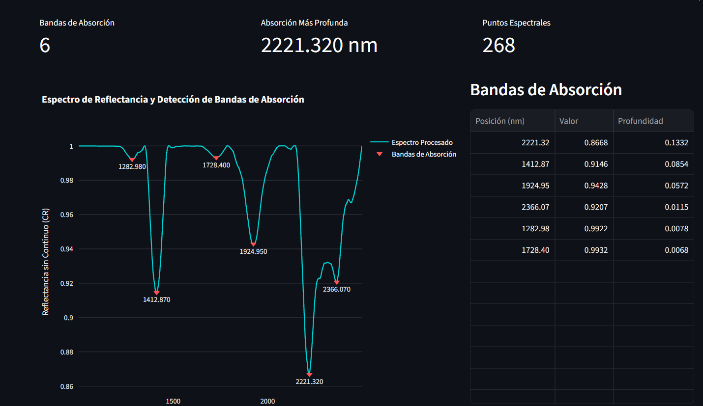
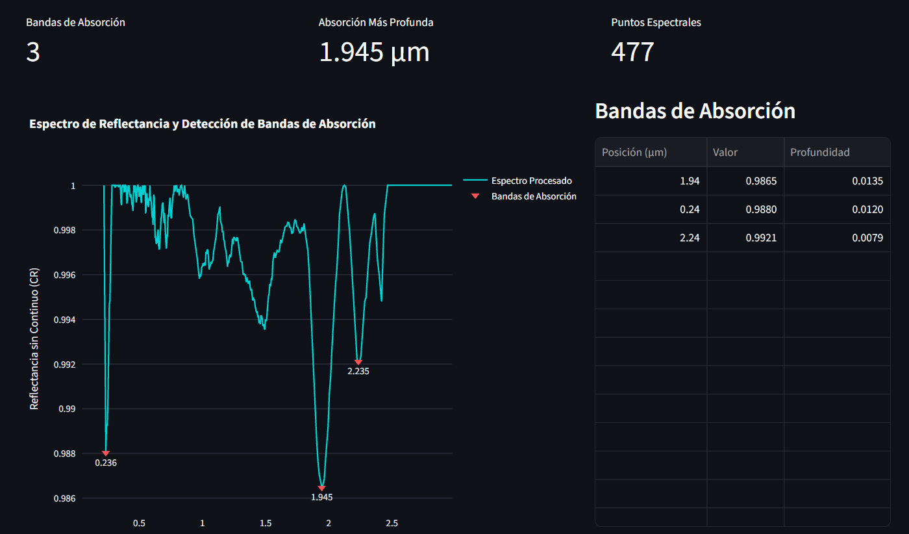

# 🔬 TecSpec | Multi-Spectral Mineral Analyzer

Aplicación web interactiva desarrollada en **Python** y **Streamlit** para el procesamiento, visualización y análisis de datos espectroscópicos orientados a caracterización mineralógica.

Integra en una sola plataforma un cargador universal multi-formato y dos pipelines de procesamiento físicamente diferenciados: **espectroscopía de emisión atómica (LIBS)** y **espectroscopía de reflectancia (VNIR-SWIR)**.

> 🚀 **Demo en vivo:** https://tecspec.streamlit.app/

---

## ✨ Características Principales

* **Doble Motor de Análisis Espectral:**
  * **Modo LIBS (Emisión Atómica):** Sustracción de continuo de plasma (*rolling min*), suavizado mediante filtro Savitzky-Golay, detección automática de picos de emisión y asignación contra una base de líneas atómicas del **NIST** (`Cu`, `Fe`, `Si`, `Al`, `Ca`, `Mg`, `Ti`, `Li`, `Na`, `K`).
  * **Modo Reflectancia (VNIR-SWIR):** Suavizado Savitzky-Golay, remoción de continuo (*Continuum Removal*) mediante envolvente convexa (*Convex Hull*) y detección automática de bandas de absorción diagnósticas.
* **Cargador Universal Multi-Formato (`src/loaders.py`):** Detecta y normaliza automáticamente archivos estándar de 2 columnas (`.csv`/`.txt`), librerías de 1 columna del **USGS `splib07a`** (filtrando valores nulos `-1.23e+034` y emparejando longitudes de onda) y archivos binarios hiperespectrales **HIDSAG** en formato **HDF5** (`.h5`/`.hdf5`).
* **Modo Demo Integrado (1 clic):** Incluye espectros livianos de muestra en `data/sample_spectra/` para probar los tres formatos de inmediato sin descargar archivos externos.
* **Visualización y Exportación:** Gráficos interactivos con Plotly (zoom, inspección por coordenada y superposición de líneas teóricas) y exportación directa de tablas de resultados en formato `.csv`.

---

## 📸 Vista Previa

*(Guarda tus capturas en la carpeta `assets/` con estos nombres o ajusta las rutas)*

| Análisis SWIR (HIDSAG HDF5) | Análisis USGS `splib07a` |
| :---: | :---: |
|  |  |

---

## 📂 Formatos de Entrada Soportados

| Fuente / Formato | Extensión | Modo Recomendado | Notas de Ingesta |
| :--- | :--- | :--- | :--- |
| **LIBS / Estándar** | `.csv`, `.txt` | LIBS (Emisión Atómica) | 2 columnas numéricas: longitud de onda (`nm`) e intensidad. |
| **USGS `splib07a`** | `.txt` | Reflectancia (VNIR-SWIR) | 1 columna de reflectancia con cabecera; admite archivo `Wavelengths` opcional para eje en `µm`. |
| **HIDSAG** | `.h5`, `.hdf5` | Reflectancia (VNIR-SWIR) | Lee el dataset `hsi_data` (cubos 3D o matrices 2D) y calcula el espectro promedio automáticamente. |

---

## 🛠️ Requisitos Previos

Antes de comenzar, asegúrate de tener instalado en tu computador:
* **Python 3.10 o superior** ([descargar aquí](https://www.python.org/downloads/)).
* **Git** ([descargar aquí](https://git-scm.com/downloads)).

---

## 💻 Instalación y Ejecución Local (Paso a Paso)

### 1. Clonar el repositorio

Abre una terminal (PowerShell en Windows, o Terminal en macOS/Linux) y ejecuta:

```bash
git clone [https://github.com/](https://github.com/)<tu-usuario>/<nombre-del-repositorio>.git
cd <nombre-del-repositorio>
```

### 2. Crear y activar el entorno virtual

**En Windows (PowerShell):**
```powershell
python -m venv venv
.\venv\Scripts\Activate.ps1
```
*(Si PowerShell bloquea la activación por permisos de scripts, ejecuta primero `Set-ExecutionPolicy -Scope Process -ExecutionPolicy Bypass` y vuelve a correr `.\venv\Scripts\Activate.ps1`.)*

**En Windows (CMD):**
```cmd
python -m venv venv
venv\Scripts\activate.bat
```

**En macOS / Linux:**
```bash
python3 -m venv venv
source venv/bin/activate
```

### 3. Instalar las dependencias

Con el entorno virtual activo (verás `(venv)` al inicio de la línea), instala las librerías exactas del proyecto:

**Windows:**
```powershell
.\venv\Scripts\python.exe -m pip install --upgrade pip
.\venv\Scripts\python.exe -m pip install -r requirements.txt
```

**macOS / Linux:**
```bash
python -m pip install --upgrade pip
python -m pip install -r requirements.txt
```

### 4. Ejecutar la aplicación

**Windows:**
```powershell
.\venv\Scripts\python.exe -m streamlit run app.py
```

**macOS / Linux:**
```bash
python -m streamlit run app.py
```

La aplicación se abrirá automáticamente en tu navegador en `http://localhost:8501`. Para detener el servidor local, presiona `Ctrl + C` en la terminal.

---

## ⚙️ Archivos HIDSAG Pesados (> 200 MB)

El archivo incluido en `data/sample_spectra/hidsag/sample_swir_mini.h5` es un recorte espacial comprimido para demostración. Si deseas cargar archivos `.h5` completos de gran tamaño en tu equipo local, crea un archivo `.streamlit/config.toml` en la raíz del proyecto con el límite deseado (en MB):

```toml
[server]
maxUploadSize = 1024
```

---

## 🗂️ Estructura del Proyecto

```text
tecspec-libs/
├── .gitignore
├── README.md
├── requirements.txt
├── app.py                     # Interfaz web y motor de análisis (LIBS + Reflectancia)
├── nist_lines.py              # Base de líneas de emisión atómica NIST y matching
├── src/
│   ├── __init__.py
│   └── loaders.py             # Cargador universal para CSV, USGS splib07a y HIDSAG HDF5
├── data/
│   └── sample_spectra/
│       ├── libs/              # Muestra de espectro LIBS (.csv)
│       ├── usgs/              # Muestra USGS splib07a + archivo de longitudes de onda (.txt)
│       └── hidsag/            # Muestra hiperespectral HIDSAG recortada (.h5)
└── assets/                    # Capturas de pantalla para documentación
```

---

## 🗺️ Roadmap (Próximas Mejoras)

* [ ] Comparación espectral automática en modo Reflectancia mediante *Spectral Angle Mapper (SAM)* y similitud de coseno contra librería USGS.
* [ ] Módulo de selección interactiva de píxeles/regiones (ROI) sobre cubos 3D HDF5.
* [ ] Integración de modelos de clasificación supervisada (PCA + Random Forest / SVM) para identificación mineralógica.
* [ ] Ampliación del catálogo de líneas de emisión atómica del NIST.

---

## 🧰 Stack Tecnológico

* **Lenguaje:** Python 3.10+
* **Procesamiento Científico:** NumPy, Pandas, SciPy, h5py
* **Interfaz y Visualización:** Streamlit, Plotly

---

## 👤 Autor

**Bastián Palma** — Estudiante de Ingeniería Civil de Minas | Análisis de Datos y Software Científico  
[GitHub](https://github.com/<tu-usuario>) • [LinkedIn](https://linkedin.com/in/<tu-perfil>)
