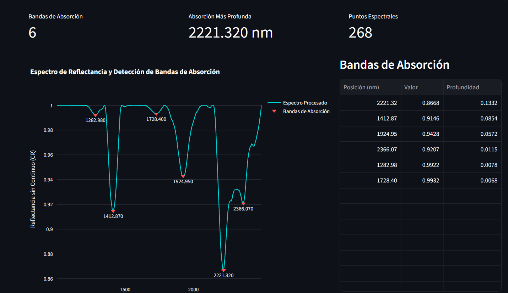
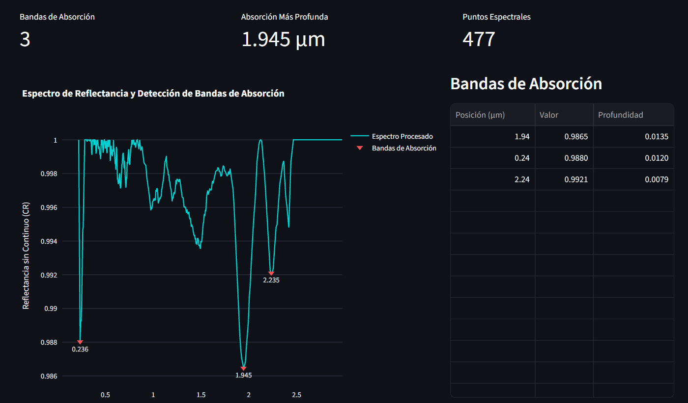

# 🔬 TecSpec | Multi-Spectral Mineral Analyzer

[🇪🇸 Leer en Español](README.es.md)

An interactive web application built with **Python** and **Streamlit** for processing, visualizing, and analyzing spectroscopic data focused on mineralogical characterization.

It unifies a multi-format data loader and two physically distinct processing pipelines into a single platform: **Laser-Induced Breakdown Spectroscopy (LIBS)** and **Reflectance Spectroscopy (VNIR-SWIR)**.

> 🚀 **Live Demo:** https://tecspec.streamlit.app/

---

## ✨ Key Features

* **Dual Spectral Analysis Engine:**
  * **LIBS Mode (Atomic Emission):** Plasma continuum subtraction (*rolling minimum*), Savitzky-Golay smoothing filter, automated emission peak detection, and matching against a **NIST** atomic emission line database (`Cu`, `Fe`, `Si`, `Al`, `Ca`, `Mg`, `Ti`, `Li`, `Na`, `K`).
  * **Reflectance Mode (VNIR-SWIR):** Savitzky-Golay smoothing, Continuum Removal via upper *Convex Hull* envelope, and automated detection of diagnostic absorption bands.
* **Universal Multi-Format Loader (`src/loaders.py`):** Automatically detects and normalizes standard 2-column files (`.csv`/`.txt`), 1-column **USGS `splib07a`** spectral library files (filtering official `-1.23e+034` null flags and pairing wavelength axes), and **HIDSAG** hyperspectral binary files in **HDF5** format (`.h5`/`.hdf5`).
* **Built-In Demo Mode (1-Click):** Includes lightweight sample spectra in `data/sample_spectra/` to test all three supported formats immediately without downloading external datasets.
* **Interactive Visualization & Export:** Dynamic Plotly charts (zoom, coordinate hover inspection, and theoretical reference line overlays) with direct `.csv` export for detected peaks and absorption tables.

---

## 📸 Preview

*(Save your screenshots inside the `assets/` folder with these filenames or update the paths accordingly)*

| SWIR Analysis (HIDSAG HDF5) | USGS `splib07a` Analysis |
| :---: | :---: |
|  |  |

---

## 📂 Supported Input Formats

| Source / Format | Extension | Recommended Mode | Ingestion Notes |
| :--- | :--- | :--- | :--- |
| **LIBS / Standard** | `.csv`, `.txt` | LIBS (Atomic Emission) | 2 numeric columns: wavelength (`nm`) and intensity (counts). |
| **USGS `splib07a`** | `.txt` | Reflectance (VNIR-SWIR) | 1-column reflectance with metadata header; supports an optional `Wavelengths` file to plot in `µm`. |
| **HIDSAG** | `.h5`, `.hdf5` | Reflectance (VNIR-SWIR) | Reads the `hsi_data` dataset (3D cubes or 2D matrices) and computes the mean spectrum automatically. |

---

## 🛠️ Prerequisites

Before getting started, make sure you have the following installed on your machine:
* **Python 3.10 or higher** ([download here](https://www.python.org/downloads/)).
* **Git** ([download here](https://git-scm.com/downloads)).

---

## 💻 Local Installation & Quickstart

### 1. Clone the repository

Open a terminal (PowerShell on Windows, or Terminal on macOS/Linux) and run:

```bash
git clone [https://github.com/](https://github.com/)<your-username>/<repository-name>.git
cd <repository-name>
```

### 2. Create and activate a virtual environment

**On Windows (PowerShell):**
```powershell
python -m venv venv
.\venv\Scripts\Activate.ps1
```
*(If PowerShell blocks script execution, run `Set-ExecutionPolicy -Scope Process -ExecutionPolicy Bypass` first, then run `.\venv\Scripts\Activate.ps1` again.)*

**On Windows (CMD):**
```cmd
python -m venv venv
venv\Scripts\activate.bat
```

**On macOS / Linux:**
```bash
python3 -m venv venv
source venv/bin/activate
```

### 3. Install dependencies

With your virtual environment active (you should see `(venv)` in your prompt), install the required packages:

**Windows:**
```powershell
.\venv\Scripts\python.exe -m pip install --upgrade pip
.\venv\Scripts\python.exe -m pip install -r requirements.txt
```

**macOS / Linux:**
```bash
python -m pip install --upgrade pip
python -m pip install -r requirements.txt
```

### 4. Run the application

**Windows:**
```powershell
.\venv\Scripts\python.exe -m streamlit run app.py
```

**macOS / Linux:**
```bash
python -m streamlit run app.py
```

The app will open automatically in your default browser at `http://localhost:8501`. Press `Ctrl + C` in the terminal to stop the local server.

---

## ⚙️ Handling Large HIDSAG Files (> 200 MB)

The sample file in `data/sample_spectra/hidsag/sample_swir_mini.h5` is a compressed spatial crop intended for lightweight demonstrations. To upload full-scale `.h5` hyperspectral cubes locally, create a `.streamlit/config.toml` file in the project root with your desired upload limit (in MB):

```toml
[server]
maxUploadSize = 1024
```

---

## 🗂️ Project Structure

```text
tecspec-libs/
├── .gitignore
├── README.md                  # Main documentation (English)
├── README.es.md               # Spanish documentation
├── requirements.txt
├── app.py                     # Web UI and spectral processing engine (LIBS + Reflectance)
├── nist_lines.py              # NIST atomic emission line database and peak matching
├── src/
│   ├── __init__.py
│   └── loaders.py             # Universal loader for CSV, USGS splib07a, and HIDSAG HDF5
├── data/
│   └── sample_spectra/
│       ├── libs/              # Sample LIBS spectrum (.csv)
│       ├── usgs/              # Sample USGS splib07a spectrum + wavelengths file (.txt)
│       └── hidsag/            # Cropped HIDSAG hyperspectral sample (.h5)
└── assets/                    # Documentation screenshots
```

---

## 🗺️ Roadmap

* [ ] Automated spectral matching in Reflectance mode using *Spectral Angle Mapper (SAM)* and cosine similarity against USGS reference libraries.
* [ ] Interactive pixel / Region of Interest (ROI) selection directly on 3D HDF5 hyperspectral cubes.
* [ ] Supervised machine learning pipelines (PCA + Random Forest / SVM) for automated mineral classification.
* [ ] Expansion of the NIST atomic emission line reference catalog.

---

## 🧰 Tech Stack

* **Language:** Python 3.10+
* **Scientific Computing:** NumPy, Pandas, SciPy, h5py
* **UI & Visualization:** Streamlit, Plotly

---

## 👤 Author

**Bastián Palma** — Mining Engineering Student | Data Analysis & Scientific Software Development  
[GitHub](https://github.com/Gandalf1309) • [LinkedIn](https://www.linkedin.com/in/bastian-palma-munizaga/)
